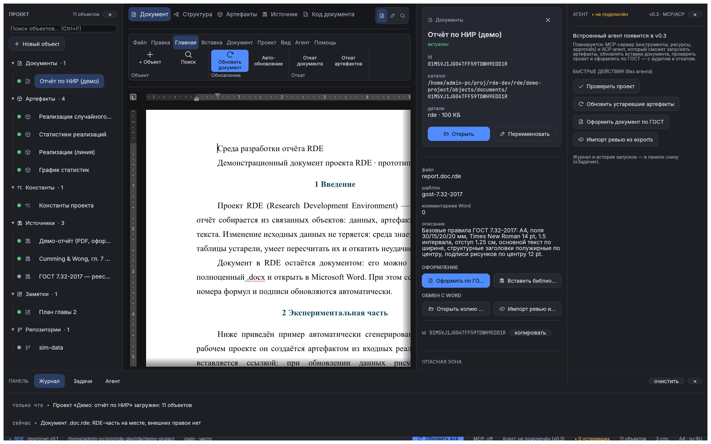

# RDE — Research Development Environment

Среда разработки отчёта: документ — один из объектов проекта, а не единственный файл. Прототип
поверх движка [WordCraft](https://github.com/storytold/wordcraft) v0.10.0 (git-субмодуль):
проект — каталог с TOML-манифестами, документ — `.doc.rde` (OOXML + `rde:doc`), артефакты —
скрипты (Python в демо) с хешами/транзакциями, источники — PDF/OCR/ревью.



*P10 «UI-долги» (2026-10-26): строка вкладок центра — одна линия (вкладки + сегментированный
переключатель режимов справа, масштаб — на ленте), инспектор 340 px и не съедает центр, тёмная тема,
DocView. Ещё: [светлая тема](docs/fidelity/gui-p10-document-light.png),
[артефакты и DAG](docs/fidelity/gui-p10-artifacts-dark.png).*

## Состояние

Текущая итерация — **GUI-02 «весь функционал из интерфейса + Проводник…»** (2026-10-29,
[ADR-0017](docs/adr/0017-file-picker-backend.md), [матрица покрытия GUI](docs/gui-coverage.md)):
все поля путей в диалогах получили кнопку **«Проводник…»** — системный выбор файла/папки
(`kdialog` в KDE, `zenity` иначе; без графики/утилит — честная деградация «введите путь вручную»,
фон, UI не блокируется, backend подменяется в тестах). Появились **недавние проекты** в «Открыть
проект…» (`~/.config/rde/recent-projects.toml`, синхронизировано с `scripts/run.sh`/`last-project`),
**валидация путей до действия** (подсказка/ошибка под полем, disabled-кнопка с причиной),
Enter/Esc/фокус в диалогах, эллипсис длинных путей с полным путём в тултипе, «Открыть в файловом
менеджере». Аудит закрыл GUI-дыры: **свойства источника** (файл — «Проводник…», копируется в объект,
или URL), **свойства репозитория** (kind/path), **редактор заметок** (паритет MCP `note_write`),
**импорт цитат BibTeX/RIS/CSL-JSON**, диалог **импорта ревью из Word** с выбором файла, имя документа
при импорте `.docx` (паритет CLI `--title`), реальное «Обновить вставки» вместо заглушки; исправлена
запись полей манифестов (`document.toml`/`source.toml`/`repo.toml` молча не сохранялись). Покрытие
GUI, исправления и честные ограничения — [`docs/gui-coverage.md`](docs/gui-coverage.md);
скриншоты — `.cache-tmp/shots/gui-pickers/`.
До GUI-02 — **M4.4 «v0.3: контекст-ссылки §8.7.2 и diff-UI правок агента»**
(2026-10-28, [ADR-0015](docs/adr/0015-m44-context-refs-and-diff-ui.md)): в чат встроенного ACP-агента
можно прикладывать **чипы контекста** — блок/абзац/комментарий документа, страница или выделенный
**регион PDF** (bbox в точках, кэш растра), выход артефакта, источник, заметка, проект/шаблон — из
структуры документа, инспектора и просмотра PDF. Тело агенту **не копируется**: уходит
`resource_link` с URI/именем/MIME/подсказкой MCP-инструмента, чтение — ленивое (R-AGT-08);
revision-scoped ссылки при устаревании помечаются «обновлена» (re-anchor по `paraId`/`block_id`).
Второй блок — **diff-UI suggested edits** (R-AGT-05): окно «Правки агента» с word-diff «было/станет»
(+N/−M слов), «Принять»/«Отклонить»/«Отклонить все», история решений; принятие идёт тем же безопасным
путём, что MCP-инструмент `suggestion_accept` — чекпоинт `.rde/agent/checkpoints`, бэкап пакета,
версия документа в store, аудит `suggestion_accept`/`suggestion_reject` (human-in-the-loop: агент не
может принять правку сам). `rde-mcp`/`rde-host` — **0 правок**, бюджет MCP не менялся
(29 / 38 103 Б / 8 886 Б).
До M4.4 — **M4.3 «v0.3: встроенный ACP-агент (DSH) и панель чата»**
(2026-10-28, [ADR-0014](docs/adr/0014-m43-builtin-acp-agent.md)): RDE получил **встроенного агента по
ACP** — DSH `--profile acp` дочерним процессом, нативная панель чата (статус, «Новый чат»/«История…»/
«Остановить»/«Закрыть сессию», селекторы модели/reasoning из `configOptions`, поток сообщений/
размышлений/tool-call'ов/плана, карточки **permission-запросов агента**, поле ввода), **интерактивные
разрешения агента** (allow/deny → выбранный `optionId`/`cancelled`, аудит `acp_permission` в
`.rde/agent/audit.log`, fail-closed по таймауту/закрытию/смене проекта) и **история в проекте**
(`.rde/agent/sessions/<id>/`; DSH историю не реплеит — RDE показывает свой транскрипт, restore =
`session/resume`). RDE-MCP для встроенного агента — **in-process streamable HTTP на loopback**
(уточнение §8.7.1: stdio не может показывать GUI-диалоги), поэтому мутации агента идут через
**существующие** GUI-approvals/чекпоинты/аудит M4.2b; для ACP-агентов без HTTP-MCP — stdio read-only
fallback. ACP-протокол изолирован в новом крейте **`rde-agent`** (официальный Rust SDK
`agent-client-protocol =3.5.0`, Apache-2.0); настройка `allow_builtin_agent` по умолчанию **выключена**
(процесс агента стартует только по «Новый чат»), любой ACP-совместимый агент настраивается командой.
До M4.3 — **M4.2b «GUI-гранты запуска скриптов и git-коммитов с подтверждением»**
(2026-10-28, [ADR-0013](docs/adr/0013-m42b-gui-run-git-grants.md)): внешним агентам из GUI доступны
**все три гранта** — отдельные подгалочки **«Разрешить запуск скриптов проекта (artifact_run)»**
и **«Разрешить git-коммиты (git_commit)»** под «Разрешить агенту изменения в проекте». Каждый
`artifact_run`/`run_cancel`/`git_commit` проходит через тот же диалог confirmation, но с
**human-readable превью** (цели/флаги запуска + предупреждение о выполнении кода, R-RUN-06;
сообщение коммита, автор и число файлов), с чекпоинтом и аудитом; fail-closed. Эффективный грант
`run_script` выдаётся **только trusted-проекту**: если проект не доверенный — предупреждение и кнопка
«Пометить проект доверенным…», открывающая существующий диалог согласия R-RUN-06. До M4.2b —
**M4.2 «интерактивные GUI-approvals»** (2026-10-27,
[ADR-0012](docs/adr/0012-m42-gui-interactive-approvals.md)): вторая галочка **«Разрешить агенту
изменения в проекте»** (по умолчанию выключена) включает грант `project_write` и GUI-хук approval:
RDE показывает «Запрос внешнего агента» с превью **«Было/Станет»** и кнопками «Разрешить один раз /
в сессии / Отклонить», перед мутацией создаётся чекпоинт, решение и `checkpoint_id` пишутся в аудит;
таймаут/закрытие/выключение → отказ (fail-closed). До M4.2 — **M4.1 «внешние агенты из GUI»**
([ADR-0011](docs/adr/0011-m41-gui-external-agents.md)): чекбокс «Разрешить доступ внешним агентам» +
встроенный фоновый MCP-сервер (loopback + bearer-токен, read-only), адрес/токен в панели «Агент»;
до M4.1 — **M2.6 «вставка/удаление абзацев документа»** (2026-10-27,
[ADR-0010](docs/adr/0010-m26-insert-delete-paragraphs.md)) и **M3 «streamable HTTP»**
(2026-10-27, [ADR-0009](docs/adr/0009-m3-streamable-http-transport.md)): у независимого MCP-слоя
([ADR-0006](docs/adr/0006-mcp-independent-layer.md): `rde-mcp` на `rmcp` 3.8.0, spec MCP
**2026-07-28**; `rde-host` — headless-реализация) появился второй транспорт для **внешних** агентов —
**streamable HTTP** на `rmcp::StreamableHttpService` + `axum`, с тем же сервером; в **M2.6**
добавлены **вставка/удаление абзацев** документа (`doc_insert`/`doc_delete`) — итого **29 инструментов**
(ресурсы, grants/approvals/чекпоинты/аудит/ревизии — из M2/M2.5). HTTP **выключен по умолчанию** (stdio —
дефолт), включается только `--transport http`, **только на loopback** и **только с bearer-токеном**
(`--token`/`--token-file`/`RDE_MCP_TOKEN`, иначе CSPRNG-генерация с однократной печатью в stderr);
`401` без токена → `RDE_UNAUTHORIZED` + аудит; `/health` — без токена и без данных проекта.
Мутации — по-прежнему только через гранты политики + approval + чекпоинт; **по умолчанию всё
запрещено** (`--approval=deny`), внешний доступ из GUI — read-only, пока пользователь явно не разрешит
изменения (и тогда — подтверждение каждого действия). До M4.1/M2.6/M3 — **M2.5** (документные
suggested edits/ревизии), **M2**
(мутации артефактов/заметок/git + job-модель), **M1** (read-only MCP-слой), **P9 «Интерфейс»** и
**P10 «UI-долги»**: закрыты дефекты §19-7 («одна линия» панелей) и §19-8 (ширина инспектора).
Прототип **v0.1** закрыт по [`docs/exit-v0.1.md`](docs/exit-v0.1.md) (P5, теги `p5-gates` /
`v0.1-prototype`) и отполирован в P6–P8.

- **459 тестов** (`#[test]`/`#[tokio::test]`) в 16 пакетах, 16 примеров. История вех и коммитов — [`CHANGELOG.md`](CHANGELOG.md).
- Демо-проект [`demo-project/`](demo-project): 12 объектов (вкл. project-level формулу σ, P3),
  документ с 11 живыми вставками; формула σ — режимы **OMML** (номер `(1)`,
  [`docs/fidelity/demo-formula.png`](docs/fidelity/demo-formula.png)) и **SVG-вектор** (P3),
  Python-артефакты, PDF-источник, библиография.
- Актуальные документы: ТЗ [`docs/tz-03.md`](docs/tz-03.md) (v03, канон; ведёт Lead), решения —
  [`docs/adr/`](docs/adr/), история — [`CHANGELOG.md`](CHANGELOG.md).

Вехи: M1 → S5 → M2.1–M2.4 → M3–M6 → P1–P8 → **P9**. Предыдущие теги: `m1-concept`, `s5-docview`,
`m2.1-project-model`, `m2.2-store`, `m2.3-run-dag`, `m2.4-ui`, `m3-doc`, `m4-templates`,
`m5-sources-review`, `ui-live`, `p1-artifacts`, `p2-store`, `p3-run-env`, `p4-doc-live`, `p5-gates`,
`p6-feedback`, `p7-feedback-fixes`, `p7-polygon`, `p8-b0`, `p8-b1`, `p8-session-end`. Критерии и
доказательства — [`docs/milestones.md`](docs/milestones.md).

## Что уже есть

| Часть | Состояние |
|---|---|
| Проект, дерево, статусы | **реальные объекты** из `demo-project/` (`rde.toml` + `objects/**`), статусы — из DAG/фактов на диске |
| Центральные вкладки | 5 вкладок: **Документ / Структура / Артефакты (DAG) / Источник / Код документа** — все на реальных данных; строка вкладок — **одна линия** без переноса |
| Интерфейс (P9/P10, M6) | **лента 9 вкладок** (Файл…Помощь) с группами, меню внутри ленты, контекстное меню дерева, диалоги проектов/настроек, поиск Ctrl+F, «Проверить и починить», «Задачи»; на вкладке «Документ» — сегментированный переключатель режимов в строке вкладок; инспектор 340 px (280–480, resizable), масштаб — на ленте |
| Темы, шрифты, иконки | **Dark / Light / System** для оболочки и DocView; вендоренные DejaVu Sans/Mono с кириллицей; иконки Phosphor (сабсет 21 глифа, MIT) |
| Документ | три режима: **«RDE»** — canvas WordCraft без его ribbon/titlebar (форк-патч `rde-docview`, feature-gate); **«WordCraft»** — весь WordApp в панели; **«Предпросмотр страниц»** — растровые страницы |
| Сохранение | **RDE — владелец сохранения**: «Сохранить проект» пишет `.doc.rde`, «Экспорт .docx» — чистая копия в `exports/`; WordCraft-autosave отключён; внешние правки детектируются по `rde:doc`/`body_hash` |
| DAG и обновление | **реальный**: узлы/рёбра по `hashed`-группам, статусы из `act_key`/`out_hash`, причины устаревания по компонентам, цикл-детект, «Обновить всё»/«Обновить связанные» |
| Артефакты и store | JCS-хеши, `schema_version` в `act_key`, glob-селекторы, входы-константы, `out_hash` в манифесте; CAS, транзакции, откат O(1), GC/pins, zstd, lock |
| Окружения и запуск | `rde-env` + `rde.lock`, согласие «проект доверенный», сеть запрещена best-effort, read-only входы, SIGTERM→grace, `provenance.json` |
| Документ: вставки | `w:sdt`-вставки значения/рисунка/таблицы/константы/даты/цитаты из артефактов; обновление из выходов, бэкапы, diff, откат; все виды вставок в демо |
| Документ: импорт `.docx` (R-DOC-39, минимальный) | **«Файл → Импорт .docx…»** или `rde import-docx <file> --project <dir>`: создаётся новый объект-документ **`[IMPORTED] имя`** (WordCraft → `.doc.rde` + `rde:doc`), **он сразу становится активным** (редактор/сохранение/вставки работают с ним), исходник **не изменяется**, происхождение — `import.json` (sha256/части/время), в журнал/CLI — предупреждения о диаграммах/SmartArt/OLE/макросах/track changes/полях Word; **выбор документа в дереве переключает редактор**, при старте открывается самый свежий документ (несколько документов в проекте); остальные форматы (`.doc/.odt/.rtf/…`), merge и полный фиделити-отчёт — v0.2 |
| Документ: правки агента (M2.5/M2.6) | suggested edits через MCP: changeset (`before/after` блока, автор, базовый `body_hash`), `suggestion_accept`/`suggestion_reject`, каждая правка — чекпоинт `.doc.rde` + версия в store (`revision_list`); прямая правка `doc_replace_range` с R-DOC-13-защитой (`expected_text`/`expected_body_hash` → `RDE_CONFLICT`); **M2.6:** `doc_insert`/`doc_delete` (вставка/удаление абзацев под approval+чекпоинтом, позиционные `bN` сдвигаются); правка только простого абзаца; символьные диапазоны и track changes Word — дальше ([ADR-0008](docs/adr/0008-document-suggested-edits-and-revisions.md), [ADR-0010](docs/adr/0010-m26-insert-delete-paragraphs.md)) |
| Формулы (P2/P3) | project-level объекты `objects/formulas/<id>` (`rde/formula@1`: LaTeX-источник, входы/фрагменты, `numbering`, `act_key`); вставки `kind="formula"` в режимах **OMML** (редактируемая формула) и **SVG-вектор** (`asvg:svgBlip` + PNG-fallback), документно-локальный номер; статусы «устарела/цель отсутствует/не вычислена/ручная правка», «где вставлено» по всем документам, обновление документа вместе с пересчётом кэшей одной транзакцией, явная миграция OMML вне реестра; нет нативного редактора (P4) и векторного экспорта/обмена LaTeX (P5) |
| Шаблоны и библиография | ГОСТ 7.32-2017 (поля/шрифты/интервалы/заголовки/подписи), библиография ГОСТ 7.0.100 из источников |
| Источники, PDF/OCR, ревью | импорт BibTeX/RIS/CSL-JSON, PDF-текст/рендер, OCR страницы, комментарии Word и импорт внешнего ревью; веб-архив — при наличии `monolith` |
| VCS, настройки, гейты | git init/status/commit/revert/log, `.gitignore`/`.gitattributes`, настройки приложения и авторы (вкл. «Разрешить внешним агентам», M4.1), i18n-каркас ru/en, экспорт диагностики, OPC-гейт, корпус docx, `xtask`/CI, перф 10k |
| Структура и Код документа | **реальные**: блоки/paraId/вставки из `.doc.rde`; манифест объекта + RDE-часть `customXml/item1.xml` |
| Агент / MCP / ACP | **MCP-сервер — M3/M2.6/M4.1/M4.2/M4.2b/M4.3** (v0.3): `rde mcp serve` — **stdio (дефолт) + streamable HTTP (opt-in)**, spec 2026-07-28, **29 инструментов** (13 read-only + 8 мутаций M2: манифест/скрипт/запуск/статус/отмена/лог/заметка/git-коммит + 6 документных M2.5: suggested edits `doc_suggest_edit`/`suggestion_list`/`suggestion_accept`/`suggestion_reject`, `doc_replace_range`, `revision_list` + 2 M2.6: `doc_insert`/`doc_delete`) + 4 ресурса `rde://…`, grants+approvals (по умолчанию deny, CLI `--approval=deny\|auto\|allowlist`), чекпоинты `.rde/agent/checkpoints` с авто-откатом, версии документа в store, аудит `.rde/agent/audit.log` (`decision`/`reason`/`checkpoint_id`), коды `RDE_*` ([ADR-0006](docs/adr/0006-mcp-independent-layer.md), [ADR-0007](docs/adr/0007-mutations-approvals-checkpoints.md), [ADR-0008](docs/adr/0008-document-suggested-edits-and-revisions.md), [ADR-0009](docs/adr/0009-m3-streamable-http-transport.md), [ADR-0010](docs/adr/0010-m26-insert-delete-paragraphs.md), [ADR-0011](docs/adr/0011-m41-gui-external-agents.md), [ADR-0012](docs/adr/0012-m42-gui-interactive-approvals.md), [ADR-0013](docs/adr/0013-m42b-gui-run-git-grants.md), [ADR-0014](docs/adr/0014-m43-builtin-acp-agent.md)); HTTP — только loopback + обязательный bearer-токен (`/mcp`, `/health`), 401 → `RDE_UNAUTHORIZED`+аудит; track changes — отдельно; **M4.1:** в настройках приложения — «Разрешить доступ внешним агентам» (встроенный HTTP-сервер, read-only, адрес/токен в панели «Агент», старт/стоп), **M4.2:** «Разрешить агенту изменения в проекте» — мутации с интерактивным подтверждением (превью «Было/Станет», AllowOnce/AllowSession/Deny, чекпоинт+аудит, fail-closed по таймауту/закрытию), **M4.2b:** отдельные подгалочки `run_script`/`git_commit` (превью целей/сообщения/автора, run — только для trusted-проекта, R-RUN-06); **M4.3:** встроенный **ACP-агент** (`rde-agent`, Rust SDK `agent-client-protocol 3.5.0`; `dsh --profile acp` по умолчанию, любой ACP-агент настраивается) + панель чата (сессии/история, поток сообщений/размышлений/tool-call/плана, permissions allow/deny, cancel, выбор модели/reasoning), RDE-MCP для сессии — in-process **HTTP-loopback** с approvals M4.2b; транскрипт в `.rde/agent/sessions/`, аудит `acp_permission`; ограничения DSH ACP v1: нет fork/load и image-промптов; URI-чипы/diff-UI — M4.4 |

## Сборка и запуск

Требования: Rust **1.99.1** (пин в `rust-toolchain.toml`), Linux с X11/Wayland и GPU (wgpu).
Системные инструменты нужны только части гейтов: LibreOffice (fidelity), `poppler-utils` и
`tesseract-ocr` + `tesseract-ocr-rus` (источники), `uv` (Python-артефакты), опционально `monolith`.
Для кнопки **«Проводник…»** (системный выбор файла/папки) нужен `kdialog` (KDE) или `zenity`;
без них (и в headless) RDE честно пишет «введите путь вручную» — остальной GUI работает.

```bash
# 1) WordCraft v0.10.0 + форк-патч DocView (один раз)
git submodule update --init --recursive

# 2) запуск приложения — одной командой: сам соберёт (если бинаря нет) и откроет GUI
./scripts/run.sh
#    с конкретным проектом:
./scripts/run.sh /путь/к/проекту
#    (запоминает последний проект: следующий ./scripts/run.sh откроет его же;
#     --rebuild — пересобрать, --print — только показать команду)

# 3) всё остальное — из окна GUI (CLI не нужен):
#    • открыть проект — «Файл → Открыть проект…» (кнопка «Проводник…» + список недавних)
#      или перетащить папку с rde.toml в окно;
#    • новый проект — «Файл → Новый проект…» (каталог — «Проводник…», проверка «пустой/не проект»);
#    • импорт .docx — «Файл → Обмен с Word → Импорт .docx…» (кнопка «Проводник…», поле «Имя документа»)
#      или перетащить .docx в окно
#      (MathType-формулы при импорте становятся нативными формулами RDE, R-DOC-44;
#       исходный .docx не изменяется, отчёт — в журнале внизу и import.json);
#    • источники — «Файл → Источники → Импорт цитат…» (BibTeX/RIS/CSL-JSON); у выбранного
#      источника — «Свойства источника…» (файл/URL, файл через «Проводник…» копируется в объект);
#    • заметки — выберите заметку в дереве: вкладка «Источник» = редактор, Ctrl+S — сохранить;
#    • сохранить/экспорт — «Файл → Сохранить проект», «Файл → Экспорт .docx».

#    другой проект RDE:
./scripts/build.sh run -p rde -- --project /путь/к/проекту
RDE_PROJECT=/путь/к/проекту ./scripts/build.sh run -p rde

# MCP-сервер (v0.3/M1, headless): stdio + JSON-RPC, GUI не создаётся
./scripts/build.sh run -p rde -- mcp serve --project /путь/к/проекту
# (по умолчанию demo-project; транспорт — stdin/stdout, политика read-only, аудит в проекте)
```

Форк-ветка WordCraft: <https://github.com/ia14borzenko/wordcraft-rde> (ветка `rde/main`);
журнал изменений — [`docs/wordcraft-fork.md`](docs/wordcraft-fork.md).

`scripts/build.sh` — обёртка над cargo: `CARGO_TARGET_DIR` (по умолчанию `/srv/yocto/rde-target`,
то же в `.cargo/config.toml`), проверка свободного места, очистка incremental при нехватке.
На другой машине переопределите `CARGO_TARGET_DIR` или удалите `target-dir` из `.cargo/config.toml`.

> **Где бинарник:** `$CARGO_TARGET_DIR/debug/rde`; на этом стенде — **`/srv/yocto/rde-target/debug/rde`**
> (`target-dir` в `.cargo/config.toml`, каталог `rde/target` **не используется** и его можно удалять).
> `./scripts/run.sh` находит бинарник сам; полная очистка — `./scripts/clean-build.sh`, после неё
> первый `run.sh` соберёт всё заново (долго).
Полная очистка — `./scripts/clean-build.sh`. Для сборки/тестов из каталога `rde/` можно и просто
`cargo …`: target-dir уже прописан.

`UV_CACHE_DIR` — если кэш `uv` вынесен из `~/.cache/uv`, экспортируйте его перед первым
разрешением окружения (`export UV_CACHE_DIR=/path/to/uv-cache`); RDE вызывает системный `uv`
(`rde-env`). Полезные переменные: `RDE_PROJECT` (путь к проекту), `RDE_PORTABLE` (portable-настройки),
`RDE_PYTHON` (fallback-интерпретатор).

### Тесты

```bash
./scripts/build.sh test --workspace   # 536 тестов (#[test]/#[tokio::test]) в 16 пакетах
```

Разбивка: core 40, **ui 131**, doc 66, run 14, hash 13, store 12, docx 11, sources 6,
templates 5, env 4, vcs 2, dag 28, **mcp 88, host 68 (28 unit + 15 headless + 14 mutations +
11 doc_mutations), agent 28 (9 unit + 17 fake-agent + 1 doctest), apps/rde (e2e MCP stdio+HTTP +
ACP) 20**. Тесты, которым нужны
внешние инструменты (LibreOffice, poppler, tesseract), проверяют наличие и пропускают проверку,
если инструмента нет; e2e встроенного агента (`apps/rde/tests/agent_acp.rs`) пропускается, если в
PATH нет `dsh`/профиля `acp`.

### MCP-сервер (stdio + streamable HTTP, v0.3/M2.6)

`rde mcp serve --project <dir>` (или `RDE_PROJECT`) — headless MCP-сервер RDE: **два транспорта** —
**stdio (дефолт)** и **streamable HTTP (opt-in)**; spec **2026-07-28** (`server/discover`, stateless,
`ttlMs`/`cacheScope`), **29 инструментов** (13 read-only M1 + 8 мутаций M2 + 6 документных M2.5 +
2 вставки/удаления абзацев M2.6),
4 ресурса `rde://…`, **grants + approvals + чекпоинты**, аудит `.rde/agent/audit.log`. Мутации
выполняются только по схеме «грант политики → approval → чекпоинт → библиотечная операция → аудит»;
**по умолчанию (`--approval=deny`) любые мутации отклоняются (`RDE_APPROVAL_DENIED`), файлы проекта
и документ не меняются**. Архитектура/TTL — [ADR-0006](docs/adr/0006-mcp-independent-layer.md),
мутации/approvals/чекпоинты/job-модель/parity-матрица UI↔MCP —
[ADR-0007](docs/adr/0007-mutations-approvals-checkpoints.md), документные suggested edits/ревизии —
[ADR-0008](docs/adr/0008-document-suggested-edits-and-revisions.md), HTTP-транспорт —
[ADR-0009](docs/adr/0009-m3-streamable-http-transport.md); независимость слоёв проверяется
`cargo tree -p rde-mcp` (не должно быть `rde-*`/`egui`).

Флаги approvals (headless, fail-closed; интерактивных подтверждений в stdin нет):

| Флаг | Что разрешает |
|---|---|
| (по умолчанию) | ничего: все мутации → `RDE_APPROVAL_DENIED`, файлы/документ не меняются |
| `--approval=auto` | `project_write` (манифест/скрипт/заметка/документные правки); `run_script` — только с `--allow-run`; `git_commit` — только с `--allow-destructive` |
| `--approval=allowlist --allow-tools=a,b,c` | только перечисленные мутирующие инструменты |
| `--policy read-only` | совместимость с M1 (= deny) |

`artifact_run` дополнительно требует `trusted = true` в `rde.toml` (R-RUN-06) и один активный job
(`RDE_BUSY`); jobs не переживают рестарт сервера. Чекпоинты — `.rde/agent/checkpoints/<ULID>/`
(manifest + копии файлов + корни store); на ошибке — авто-откат; внешняя правка файла/документа при
`expected_sha256`/`expected_text`/`expected_body_hash` → `RDE_CONFLICT`.

**Внешние агенты из GUI (M4.1/M4.2/M4.2b, R-MCP-02/R-MCP-05/R-MCP-06):** Настройки приложения →
«Внешние агенты» → «Разрешить доступ внешним агентам (MCP, streamable HTTP)» → «Сохранить»; RDE
поднимает встроенный фоновый сервер (loopback, эфемерный порт) с bearer-токеном и **read-only**
политикой по умолчанию. Вторая галочка **«Разрешить агенту изменения в проекте»** (M4.2, по умолчанию
выключена) добавляет грант `project_write` и GUI-approval: на каждое мутирующее действие RDE показывает
диалог «Запрос внешнего агента» с превью «Было/Станет»/аргументами и кнопками **«Разрешить один раз /
в сессии / Отклонить»**, создаёт чекпоинт и пишет решение+`checkpoint_id` в аудит; без ответа 5 минут /
при выключении доступа / смене проекта / закрытии окна — отказ (fail-closed). **M4.2b:** под ней —
**отдельные подгалочки** «Разрешить запуск скриптов проекта (artifact_run)» и «Разрешить git-коммиты
(git_commit)»; диалог для них показывает цели/`include_dependents`/`force` и предупреждение о
выполнении кода артефактов (R-RUN-06), `job_id` отмены или сообщение/автора/число файлов коммита.
**Запуск скриптов возможен только для `trusted`-проекта** (R-RUN-06): если проект не доверенный, рядом
с галочкой — предупреждение «запуск скриптов отключён» и кнопка **«Пометить проект доверенным…»**,
открывающая существующий диалог согласия (после подтверждения — `trusted = true` и перезапуск сервера
с run-грантом). Панель «Агент» показывает статус/URL/режим грантов, токен (по кнопке «Показать
токен»), кнопки «Копировать адрес/токен», «Остановить/Запустить доступ»; статус-бар — `MCP: on :порт
(rw+run+git)`. Для CI/скриптов — CLI-путь ниже (`--token-file`, `--allow-run`, `--allow-destructive`).

**Встроенный агент (M4.3, R-AGT-01/02/04/06):** Настройки приложения → «Встроенный агент (ACP)» →
☑ «Разрешить встроенного агента (ACP: DSH)» + команда `dsh` / args `--profile acp` → «Сохранить».
Панель «Агент» → блок **«Встроенный агент (ACP)»**: статус (`выкл./не запущен/запуск…/готов/работает…/
ошибка/отключён`), кнопки **«Новый чат»** (форма грантов сессии: ☑ правки проекта — каждое действие
через GUI-approval M4.2b; ☐ запуск скриптов — только trusted; ☐ git-коммиты), **«История…»**
(`session/list` по `cwd` проекта + локальные сессии; restore = `session/resume` — RDE показывает свой
транскрипт), **«Остановить»** (`session/cancel`), **«Закрыть сессию»** (`session/close` + остановка
чат-MCP-порта), «Повторить»; селекторы **модели/reasoning** из `configOptions` DSH; лента сообщений/
размышлений (переключатель «показать размышления», по умолчанию скрыты)/карточек tool-call (title/kind/
status/content, `rawInput` в collapsing)/плана/карточек **permission-запросов агента** (кнопки по
`options[].kind`: разрешить/отклонить; решение → выбранный `optionId` или `cancelled`, запись в аудит);
поле ввода (Enter — отправить, Shift+Enter — перенос); статус-бар — `Агент: ACP — сессия/выкл.`.
Мутации агента через RDE-инструменты идут **тем же** путём, что у внешних агентов: RDE поднимает
in-process MCP HTTP **на время чат-сессии** (loopback + bearer; уточнение §8.7.1 — stdio не может
показывать GUI-диалоги) → approval с превью/чекпоинтом/аудитом M4.2b; ACP-агенты без HTTP-MCP получают
stdio `rde mcp serve --approval=deny` (read-only, ограничение видно в панели). История — в проекте:
`.rde/agent/sessions/<id>/session.toml` + `transcript.jsonl` (атомарно, без секретов; в git не
попадает); решения permission — `.rde/agent/audit.log` (`tool:"acp_permission"`, SHA-256 tool-call
JSON, `allow|deny`, kind/timeout/cancel). Провайдер/API-ключи — **только в профиле DSH**, RDE их не
дублирует. Ограничения DSH ACP v1: нет `session/load`/`fork` и image-промптов (R-AGT-04 — деградация
до текста), история не реплеится, одна активная сессия на проект; LLM-тур — ручная проверка (в CI/песочнице
проверены только handshake/сессии). Архитектура — [ADR-0014](docs/adr/0014-m43-builtin-acp-agent.md).

**Контекст-ссылки и diff-UI правок (M4.4, R-AGT-03/05/08; [ADR-0015](docs/adr/0015-m44-context-refs-and-diff-ui.md)):**
кнопки **«В чат»** — в колонке «в чат» таблицы «Структура» (у каждого блока), в инспекторе объекта
(документ → проект, источник, заметка, артефакт → первый выход) и в просмотре PDF-источника
(«В чат: страница N» / «В чат: выделенный регион» после drag-выделения на отрисованной странице;
bbox пересчитывается в точки PDF и показывается в подсказке). Приложенные ссылки — **чипы** строкой
«Контекст (N):» над полем ввода (× удаляет, «очистить» — все); при отправке тело не копируется —
агент получает `resource_link` (uri/name/mimeType/description с указанием MCP-инструмента и
аргументов) и читает лениво. Ограничения честные: PDF-источник и заметки RDE-MCP читать пока не умеет
(`pdf_*`/`note_read` не реализованы) — в их `description` уходит короткий сниппет текста; image-регион
не отправляется (DSH ACP v1 `promptCapabilities.image=false`) — регион = текст страницы + `page`/`bbox`/
`pageSize`. **Правки агента:** лента «Агент → Правки агента…» или кнопка **«Правки… (N)»** в панели
чата открывают окно word-diff; «Принять» — чекпоинт + версия документа + аудит (как MCP
`suggestion_accept`), «Отклонить» — решение пользователя с аудитом; частичное принятие — pending-список
по одной правке. История версий — «История документа»/store; окно показывает последние решения.

**Транспорт streamable HTTP (M3, R-MCP-02/R-MCP-05; выключен по умолчанию):**
`rde mcp serve --project <dir> --transport http --bind 127.0.0.1:8765` — тот же сервер по HTTP
(`POST /mcp`, spec 2026-07-28 stateless) + диагностический `GET /health` (без токена и без данных
проекта). **Только loopback** (`0.0.0.0`/LAN/`[::]`/имя хоста → код 2) и **обязательный
bearer-токен**: `--token` / `--token-file <0600>` / `RDE_MCP_TOKEN`; если не задан — 32 байта из
CSPRNG, hex, печатается в **stderr один раз** (на диск/в аудит не пишется; ротация — рестарт).
Клиент передаёт `Authorization: Bearer <токен>`; без/с неверным токеном — `401` + `RDE_UNAUTHORIZED`
+ `WWW-Authenticate`, отказ аудируется (`tool="http"`, `reason="auth"`); токен в URL не принимается
и не логируется. TLS/внешние интерфейсы — вне scope M3 (loopback + туннель пользователя).
Сниппет для внешнего клиента (R-MCP-06, Claude Code и др.): MCP-сервер с `type: "http"`,
`url: "http://127.0.0.1:8765/mcp"`, заголовок `Authorization: Bearer <токен>`.

**Правки документа (M2.5, R-AGT-05):** агент не перезаписывает текст молча — `doc_suggest_edit`
создаёт **changeset-предложение** (`before`/`after` блока, автор, базовый `body_hash`) в
`.rde/agent/suggestions/`, документ не меняется; `suggestion_accept` (approval+чекпоинт+версия в store)
или `suggestion_reject`; `doc_replace_range` — прямая правка с approval для случаев без ревью;
`revision_list` — история версий документа; `revision_restore`/`checkpoint_restore` — API хоста/UI
(MCP-инструментами не публикуются). **Вставка/удаление абзацев (M2.6):** `doc_insert` (якорь/конец,
`after|before`, стиль) и `doc_delete` (по `block_id`+`expected_text`) — прямые mutating-инструменты под
approval+чекпоинтом; `block_id` `bN` после операции сдвигаются (перечитывайте `doc_outline`); удалить
последний блок/абзац со вставками нельзя. Правятся только простые абзацы; символьные диапазоны
(run-aware) и track changes Word — M2.7/отдельно.

```bash
./scripts/build.sh test -p rde-doc -p rde-mcp -p rde-host   # домен + unit/integration слоя
./scripts/build.sh test -p rde                               # e2e: rmcp-клиент по stdio и HTTP

# 1) default deny: мутация отклоняется, файлы не меняются (stdout — только JSON-RPC)
META='{"io.modelcontextprotocol/protocolVersion":"2026-07-28","io.modelcontextprotocol/clientCapabilities":{}}'
{ printf '{"jsonrpc":"2.0","id":1,"method":"server/discover","params":{"_meta":%s}}\n' "$META"
  printf '{"jsonrpc":"2.0","id":2,"method":"tools/list","params":{"_meta":%s}}\n' "$META"; } \
  | ./target/debug/rde mcp serve --project demo-project 2>/tmp/rde-mcp.log | head -2
# tools/list: 29 инструментов (13 read-only + 12 мутаций + 4 служебных), M1/M2-порядок не переставлен

# 2) auto: явный флаг → мутация выполняется, создаётся чекпоинт и аудит
{ printf '{"jsonrpc":"2.0","id":1,"method":"server/discover","params":{"_meta":%s}}\n' "$META"
  printf '{"jsonrpc":"2.0","id":2,"method":"tools/call","params":{"name":"note_write","arguments":{"note_id":"<id из note_list>","content":"# M2 smoke\n"},"_meta":%s}}\n' "$META"; } \
  | ./target/debug/rde mcp serve --project demo-project --approval=auto 2>/tmp/rde-mcp-auto.log | tail -1
# demo-project/.rde/agent/checkpoints/<ULID>/manifest.json, demo-project/.rde/agent/audit.log

# 3) streamable HTTP (M3): адрес и токен печатаются в stderr при старте
./target/debug/rde mcp serve --project demo-project --transport http --bind 127.0.0.1:8765 &
curl -s http://127.0.0.1:8765/health                                  # 200, без токена/данных проекта
curl -s -o /dev/null -w '%{http_code}\n' -X POST http://127.0.0.1:8765/mcp \
  -H 'Content-Type: application/json' -d '{}'                         # 401 (нужен bearer-токен)
# с токеном из stderr: заголовки Authorization: Bearer <токен>, MCP-Protocol-Version: 2026-07-28,
# Mcp-Method: server/discover, Accept: application/json, text/event-stream

# 4) документные suggested edits (M2.5): doc_suggest_edit → suggestion_list →
#    suggestion_accept (approval) → revision_list; документ меняется только после accept
# 5) job-модель запуска (data-артефакт не требует uv: job сразу завершается skipped/succeeded)

# независимость (пусто = доказано)
cargo tree -p rde-mcp  | grep -E "egui|eframe|rde-ui|wordcraft|rde-host|rde-core|rde-dag|rde-doc|rde-store"
cargo tree -p rde-host | grep -E "egui|eframe|rde-ui"
```

### Headless-скриншоты (egui_kittest)

Рендер идёт виртуально через `egui_kittest` + wgpu (offscreen): окна не открываются, дисплей не
нужен.

```bash
# документ (по умолчанию тёмная тема)
./scripts/build.sh run -p rde-ui --example screenshot -- /tmp/rde-document.png document
# реальный проект вместо демо: RDE_PROJECT=/путь/к/проекту (аргументы те же)
RDE_PROJECT=/home/admin-pc/Documents/rdeprojects ./scripts/build.sh run -p rde-ui --example screenshot -- /tmp/rde-vkr.png document "v00.03"

# артефакты/DAG, выбран объект по части названия
./scripts/build.sh run -p rde-ui --example screenshot -- /tmp/rde-artifacts.png artifacts "Статистики"

# светлая тема: аргументы out tab объект logs_tab action theme
./scripts/build.sh run -p rde-ui --example screenshot -- /tmp/rde-light.png document "Отчёт по НИР" 0 "" light
```

Вкладки: `document | structure | artifacts | source | code`; 4-й аргумент — нижняя панель
(0 журнал, 1 задачи, 2 агент), 5-й — действие (`update`, `insert-value`, `insert-figure`, …),
6-й — тема (`dark | light | system`).

### Гейты и проверки

```bash
./scripts/build.sh run -p xtask -- ci       # тесты ядра + docx-гейты + схемы
./scripts/build.sh run -p xtask -- demo     # демо: обновление артефактов, вставки, fidelity
./scripts/build.sh run -p xtask -- perf     # 10k объектов (docs/perf/10k.json)
./scripts/build.sh run -p xtask -- fidelity # только fidelity демо-документа
```

## Структура

```
rde/
  apps/rde/            # eframe-приложение (окно)
  crates/rde-core/     # модель проекта: манифесты, JSON Schema, загрузчик, статусы, CRUD
  crates/rde-hash/     # канонизация (JCS), Merkle, group/in/script/params/env → act_key
  crates/rde-store/    # CAS, атомарная запись, журнал транзакций, откат, GC, индекс
  crates/rde-run/      # исполнение скриптов артефактов: workdir, логи, timeout/cancel
  crates/rde-env/      # окружения (uv/pixi/pnpm), rde.lock, digest → env_hash
  crates/rde-dag/      # act_key/out_hash ledger, статусы, топологическое обновление
  crates/rde-doc/      # .doc.rde: OOXML + rde:doc, вставки, сохранение, ревью, бэкапы, suggested edits/ревизии (M2.5)
  crates/rde-docx/     # docx fidelity-гейты: части, roundtrip, LO-оракул, OPC
  crates/rde-templates/# ГОСТ 7.32-2017 и профили, библиография ГОСТ 7.0.100
  crates/rde-sources/  # импорт цитат, PDF-текст/рендер, OCR, веб-архив
  crates/rde-vcs/      # git init/status/commit/revert/log/diff, .gitignore/.gitattributes
  crates/rde-mcp/      # MCP-слой (v0.3/M2.6): контракт RdeHost, DTO/схемы, 29 инструментов, ресурсы, grants/approvals, хуки, rmcp-сервер (stdio + streamable HTTP)
  crates/rde-agent/    # M4.3/M4.4: ACP-клиент встроенного агента (Rust SDK agent-client-protocol 3.5.0): воркер, сессии, поток session/update, permissions, cancel, fail-closed; resource_link-вложения промпта; нейтральные DTO
  crates/rde-host/     # headless-реализация контракта поверх библиотек RDE (чтение, мутации+чекпоинты, документные правки/ревизии, jobs; без egui/rde-ui)
  crates/rde-ui/       # лента, панели, вкладки, DocView, темы, шрифты, иконки; встроенный MCP HTTP + GUI-approvals для внешних агентов (M4.1/M4.2), панель чата встроенного ACP-агента (M4.3), контекст-ссылки/чипы §8.7.2 и diff-UI suggested edits (M4.4)
  demo-project/        # демо-проект: rde.toml, objects/**; документ — .doc.rde
  docs/schema/         # сгенерированные JSON Schema манифестов
  docs/fidelity/       # отчёты docx-гейтов и актуальные скриншоты интерфейса
  docs/tz-03.md        # ТЗ v03 — канон (истина последней инстанции)
  docs/adr/            # архитектурные решения (0001–0003, 0005–0015)
  scripts/build.sh     # cargo-обёртка: target на /srv/yocto/rde-target + guard
  .cargo/config.toml   # target-dir на внешний диск
  vendor/wordcraft/    # git-субмодуль форка ia14borzenko/wordcraft-rde, ветка rde/main
  patches/wordcraft/   # экспорт патчей форка (bootstrap до публикации)
```

## Документация

- [`docs/tz-03.md`](docs/tz-03.md) — ТЗ v03 (канон): требования, статусы реализации, отклонения,
  открытые решения.
- [`docs/adr/`](docs/adr/) — архитектурные решения: [0001](docs/adr/0001-repo-layout-and-build.md)
  (репозиторий/сборка/форк), [0002](docs/adr/0002-component-boundaries.md) (границы крейтов),
  [0003](docs/adr/0003-deviations-from-tz02.md) (7 отклонений от ТЗ v02 и решения),
  [0005](docs/adr/0005-formulas-and-values-as-project-objects.md) (формулы как объекты проекта),
  [0006](docs/adr/0006-mcp-independent-layer.md) (независимый MCP-слой `rde-mcp`/`rde-host`),
  [0007](docs/adr/0007-mutations-approvals-checkpoints.md) (M2: мутации — grants/approvals/чекпоинты,
  job-модель, parity-матрица UI↔MCP),
  [0008](docs/adr/0008-document-suggested-edits-and-revisions.md) (M2.5: документные suggested
  edits/правки блоков/ревизии),
  [0009](docs/adr/0009-m3-streamable-http-transport.md) (M3: транспорт streamable HTTP — loopback +
  bearer-токен, opt-in),
  [0010](docs/adr/0010-m26-insert-delete-paragraphs.md) (M2.6: вставка/удаление абзацев документа),
  [0011](docs/adr/0011-m41-gui-external-agents.md) (M4.1: внешние агенты из GUI — встроенный MCP HTTP,
  настройка «Разрешить»),
  [0012](docs/adr/0012-m42-gui-interactive-approvals.md) (M4.2: интерактивные GUI-approvals — мутации
  с подтверждением/превью),
  [0013](docs/adr/0013-m42b-gui-run-git-grants.md) (M4.2b: GUI-гранты `run_script`/`git_commit` —
  отдельные подгалочки, human-readable превью, run только для trusted),
  [0014](docs/adr/0014-m43-builtin-acp-agent.md) (M4.3: встроенный ACP-агент DSH — `rde-agent` на Rust
  SDK 3.5.0, панель чата, permissions, HTTP-loopback RDE-MCP, транскрипт в проекте),
  [0015](docs/adr/0015-m44-context-refs-and-diff-ui.md) (M4.4: контекст-ссылки §8.7.2 — URI-схема,
  чипы, `resource_link`, PDF-регион; diff-UI suggested edits — word-diff, accept с
  чекпоинтом/версией/аудитом).
- [`CHANGELOG.md`](CHANGELOG.md) — история вех M1–P10 и v0.3-M4.4: что добавлено/изменено/исправлено.
- [`docs/exit-v0.1.md`](docs/exit-v0.1.md) — exit-критерий v0.1 и что осталось за фазой.
- [`docs/milestones.md`](docs/milestones.md) — критерии и доказательства вех.
- [`docs/state.md`](docs/state.md) — снимки состояния проекта и форка.
- [`docs/wordcraft-fork.md`](docs/wordcraft-fork.md) — журнал изменений WordCraft (форк-политика).
- [`docs/fidelity/README.md`](docs/fidelity/README.md) — что проверяют docx-гейты.

## Честные ограничения

- **PDF** — внешние CLI poppler (`pdftotext`/`pdfinfo`/`pdftoppm`), Linux-first; pdfium
  (`pdfium-render`) и PDF-экспорт — v0.2, см. [ADR-0003](docs/adr/0003-deviations-from-tz02.md) §2.
- **OCR** — только tesseract CLI; RapidOCR/PP-OCRv5 как дефолт, `OcrEngine` и CER-гейты — v0.2 (§3).
- **Веб-архив** — работает только при установленном `monolith`; компонент не вендорен (§4).
- **Шрифты** — вендорены DejaVu (Bitstream Vera), а не Liberation OFL; `NOTICE` требует обновления,
  выбор — за владельцем (§5).
- **Импорт `.docx`** — минимальный (R-DOC-39): только `.docx`, конвертация WordCraft без полного
  фиделити-отчёта/merge; при нескольких документах в проекте редактор открывает «основной» (первый)
  — multi-document UI и импорт остальных форматов — v0.2.
- **Правка TOML** — `artifact.toml` перезаписывается из модели, комментарии/порядок теряются;
  `toml_edit` — v0.2 (§6).
- **Режимы обновления** — реализован только `manual`; `watch`/`strict` — v0.2 (§7).
- **Формулы** (R-DOC-21/22, ADR-0005) — **P2/P3 готовы**: project-level объекты формул
  (LaTeX-источник, входы/фрагменты, `act_key`, кэши OMML/SVG/PNG в CAS), вставки
  `kind="formula"` в режимах OMML и SVG-вектор (фикс writer'а WordCraft — P2.5), документно-локальная
  нумерация, статусы/«где вставлено», транзакционное обновление документа, явная миграция
  существующих OMML. Нет нативного редактора `equation_tab` в RDE (P4), векторного экспорт-режима
  docx/PDF с гейтами и обмена LaTeX (P5); Word-совместимость svgBlip — по спецификации (Word на
  стенде нет), проверено LO-оракулом; подробности — [ТЗ §5.7.5](docs/tz-03.md) и
  [`docs/state.md`](docs/state.md).
- **MCP-сервер** — **M3/M2.6/M4.1/M4.2/M4.2b/M4.3** (v0.3, [ADR-0006](docs/adr/0006-mcp-independent-layer.md),
  [ADR-0007](docs/adr/0007-mutations-approvals-checkpoints.md),
  [ADR-0008](docs/adr/0008-document-suggested-edits-and-revisions.md),
  [ADR-0009](docs/adr/0009-m3-streamable-http-transport.md),
  [ADR-0010](docs/adr/0010-m26-insert-delete-paragraphs.md)): `rde mcp serve` (stdio **и** streamable
  HTTP — opt-in, loopback + bearer-токен, spec 2026-07-28, 29 инструментов = 13 read-only + 8 мутаций
  M2 + 6 документных M2.5 + 2 M2.6, 4 ресурса, grants/approvals/чекпоинты, аудит, job-модель запуска,
  suggested edits/ревизии документа). Не входит в M3 и запланировано: TLS/внешние интерфейсы — вне
  scope (только loopback; внешний доступ — туннель/reverse-proxy пользователя),
  legacy-сессии MCP/MRTR-approvals — не включены; символьные диапазоны (run-aware, M2.7) и
  вставка таблиц/рисунков (M3+), полные track changes Word R-DOC-32 (отдельная веха),
  GUI-диалог approval с diff (M4.2), diff-UI suggested edits и URI-чипы (M4.4) — готовы;
  MCP-инструментов `checkpoint_*`/`revision_restore` нет (откат — API хоста/UI), jobs не переживают
  рестарт; правки документа — только простой абзац.
- **Встроенный агент** (M4.3, [ADR-0014](docs/adr/0014-m43-builtin-acp-agent.md)) — **готов**: ACP-клиент
  `rde-agent` (Rust SDK 3.5.0), `dsh --profile acp` по умолчанию, панель чата, permissions, cancel,
  история в проекте. Ограничения протокола DSH ACP v1: **нет** `session/load`, `fork`/delete сессий,
  additional directories и **image-промптов** (R-AGT-04 «скриншот региона в чат» — деградация до
  текста/метаданных); история **не реплеится** агентом (RDE показывает свой транскрипт, restore =
  `session/resume`); одна активная сессия на проект; LLM-тур требует провайдерских ключей в профиле
  DSH (e2e проверяет handshake/сессии, реальный диалог — ручная проверка); ACP-агенты без HTTP-MCP —
  read-only stdio fallback. **M4.4** — URI-чипы/`resource_link` и diff-UI suggested edits **готовы**
  ([ADR-0015](docs/adr/0015-m44-context-refs-and-diff-ui.md)): оговорки — PDF/заметки отдают сниппет
  (нет MCP `pdf_*`/`note_read`), image-регион не отправляется (регион = текст страницы + bbox),
  комментарии адресуются числовым `w:id`, «В чат» из выделения DocView — не начат (структура/
  инспектор/PDF).
- **За пределами v0.1** — `.rde`-пакет шаринга (R-ART-10), ГОСТ 2.105 (рамки/штампы) и вузовские
  профили, OCR-гейты — v0.2; полная XSD-валидация ECMA-376 — v1.0.
- **Word** — Microsoft Word/Word COM на стенде отсутствует: открываемость проверяется LO-оракулом
  (LibreOffice → PDF) и OPC-валидацией, а не Word; Windows-CI — v1.0.
- **Платформа** — Linux-first (X11; Wayland best-effort); GUI-job CI не блокирующий
  (`continue-on-error`) до раннера с GPU.
- **i18n** — каркас ru/en: меню/вкладки/панель действий переведены, диалоги и журнал — русские.
- **P8** — B1.2/B2/B3 (reconcile `rde:doc` ↔ `document.xml`, hash/diff таблиц, kittest-матрица
  действий) остаются в бэклоге.

## Лицензия

MIT OR Apache-2.0; атрибуция сторонних компонентов — в [NOTICE](NOTICE). Политика изменений
WordCraft и форк-ветки — [`docs/wordcraft-fork.md`](docs/wordcraft-fork.md) и
[ADR-0001](docs/adr/0001-repo-layout-and-build.md).
