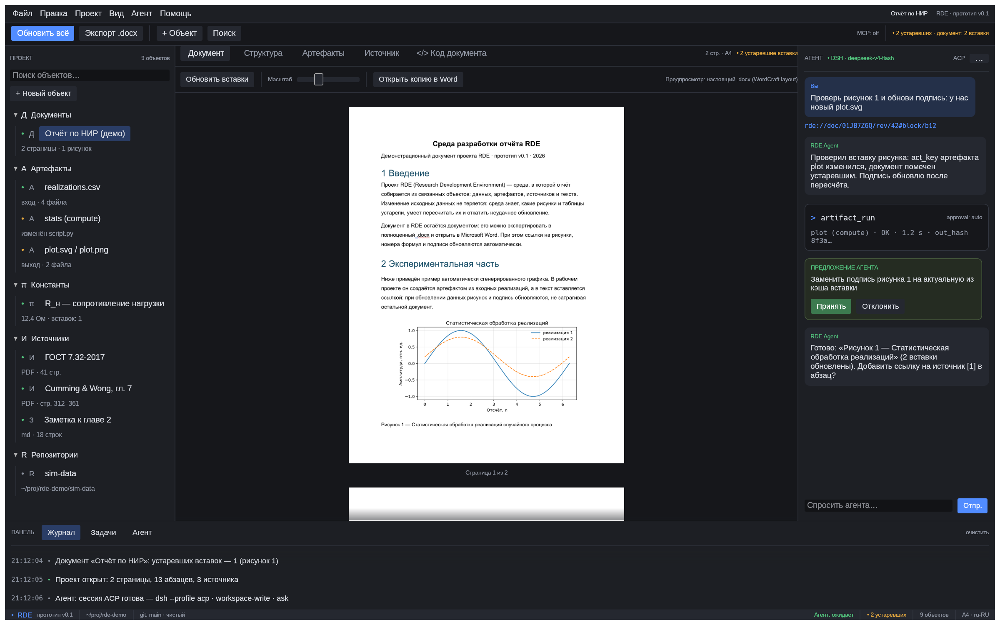

# RDE — Research Development Environment (прототип)

Среда разработки отчёта: документ — один из объектов проекта, а не единственный файл. Это первая
итерация «общего вида концепции» поверх движка [WordCraft](https://github.com/storytold/wordcraft)
v0.10.0 (git-субмодуль).



## Что уже есть в прототипе

| Часть | Состояние |
|---|---|
| Дерево проекта (документы, артефакты, константы, источники, заметки, репозитории) | UI готов, данные — mock |
| Центральные вкладки: Документ / Структура / Артефакты (DAG) / Источник / Код документа | UI готов |
| **Документ** | **настоящий `.docx`**: читается движком WordCraft, размечается его layout-движком, страницы растеризуются и показываются в окне |
| DAG артефактов со статусами «актуален/устарел» и объяснением причины | mock-диаграмма |
| Панель агента (ACP/DSH), предложения, tool-calls | mock-чат |
| Журнал/задачи, статус-бар, меню, тёмная тема | UI готов |
| Экспорт `.docx`, обновление вставок, реальные транзакции, CAS, шаблоны ГОСТ, MCP-сервер | **следующие итерации** (см. `.agent/plan-v01.md`) |

## Сборка и запуск

Требования: Rust 1.99.x (пин в `rust-toolchain.toml`), Linux с X11/Wayland и GPU (wgpu).

```bash
git submodule update --init --recursive   # WordCraft v0.10.0
cargo build --release -p rde              # приложение
cargo run -p rde                          # окно RDE (демо-проект)
```

### Концепт-скриншот без видимого окна (headless)

```bash
cargo run -p rde-ui --example screenshot -- /tmp/rde-concept.png
```

Рендер идёт виртуально через `egui_kittest` + wgpu (offscreen): окна не открываются, дисплей не нужен.

## Структура

```
rde/
  apps/rde/            # eframe-приложение (окно)
  crates/rde-core/     # модель проекта (пока демо-данные)
  crates/rde-ui/       # каркас UI + реальный предпросмотр документа
  fixtures/            # demo-report.docx (собран командами WordCraft)
  vendor/wordcraft/    # git-субмодуль v0.10.0 (не изменяется без записи в docs/wordcraft-fork.md)
  docs/adr/            # архитектурные решения
  docs/wordcraft-fork.md  # журнал любых изменений исходников WordCraft
```

## Документация

- [`docs/adr/0001-repo-layout-and-build.md`](docs/adr/0001-repo-layout-and-build.md) — решения по
  репозиторию, вендорингу, CI, форк-политике.
- [`docs/wordcraft-fork.md`](docs/wordcraft-fork.md) — журнал изменений WordCraft.
- `.agent/tz-02.md` — ТЗ; `.agent/plan-v01.md` — детальный план; `refs/` — первоисточники (вне репо).

Лицензия: MIT OR Apache-2.0 (с атрибуцией WordCraft и зависимостей в NOTICE — добавится до релиза).
