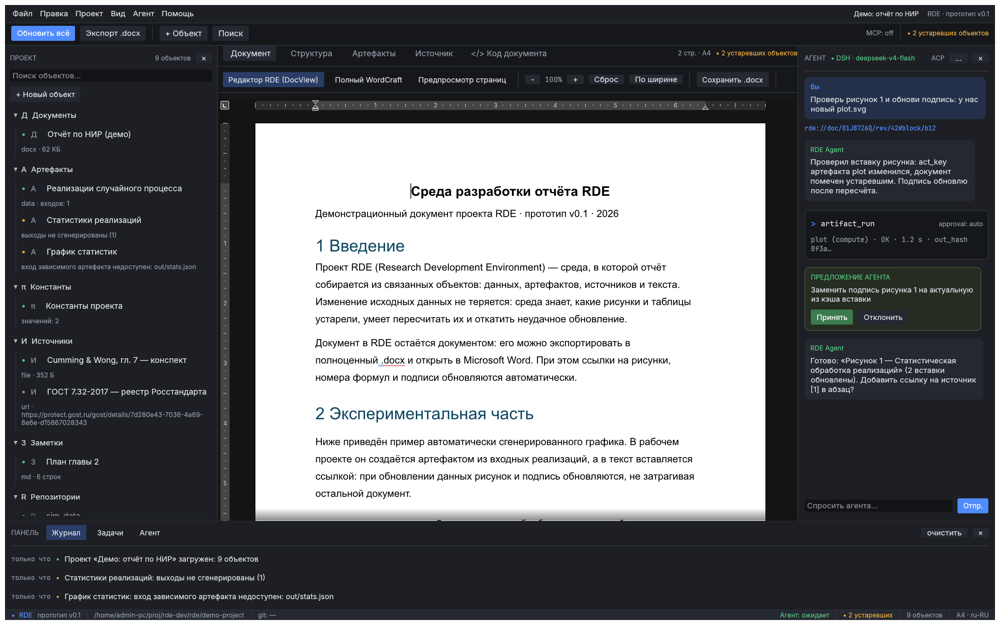

# RDE — Research Development Environment (прототип)

Среда разработки отчёта: документ — один из объектов проекта, а не единственный файл. Это первая
итерация «общего вида концепции» поверх движка [WordCraft](https://github.com/storytold/wordcraft)
v0.10.0 (git-субмодуль).



> История: `concept-v0.1.png` — предпросмотр страниц; `concept-v0.2.png` — полный WordCraft
> внутри панели; `concept-v0.3.png` — чистый DocView; `m2.1-*.png` — M2.1: дерево/статусы/журнал/
> DAG/источники из реального проекта на диске

## Вехи

Текущая: **M2.1 «Модель проекта и схемы»** — проект на диске (`rde.toml` + `objects/**`),
типизированные TOML-манифесты с JSON Schema, реальное дерево/статусы/DAG/журнал в UI.
Предыдущие: M1 «Концепт и интеграция WordCraft» (тег `m1-concept`), S5 «Чистый DocView» (тег `s5-docview`).
История и критерии вех: [`docs/milestones.md`](docs/milestones.md).

## Что уже есть в прототипе

| Часть | Состояние |
|---|---|
| Дерево проекта (документы, артефакты, константы, источники, заметки, репозитории) | **реальные объекты** из `demo-project/` (`rde.toml` + `objects/**`), статусы вычисляются из фактов на диске |
| Центральные вкладки: Документ / Структура / Артефакты (DAG) / Источник / Код документа | UI готов |
| **Документ** | три режима: **«Редактор RDE (DocView)»** — canvas WordCraft без его ribbon/titlebar (форк-патч `rde-docview`, feature-gate), ввод/вёрстка/undo как в WordCraft; **«Полный WordCraft»** — весь WordApp в панели (для сравнения); **«Предпросмотр страниц»** — растровые страницы |
| Сохранение | **одна кнопка «Экспорт .docx»** в верхней панели: RDE сохраняет текущий документ в `demo-project/exports/`; WordCraft-autosave отключён — решения о сохранении принимает RDE. Пока это экспорт; «Сохранить проект» (`.doc.rde`, транзакции) — M3 |
| DAG артефактов | **реальный**: узлы/статусы из манифестов, рёбра — из `hashed`-групп; причины устаревания показаны |
| Панель агента (ACP/DSH), предложения, tool-calls; вкладки «Структура»/«Код документа» | mock (следующие вехи) |
| Панели (дерево, агент, журнал) | скрываются: × в заголовке панели или меню «Вид» |
| Журнал | **реальный** журнал загрузки проекта (сводка + предупреждения по объектам) |
| Экспорт `.docx`, обновление вставок, CAS/транзакции, шаблоны ГОСТ, MCP-сервер | **следующие итерации** (см. `.agent/plan-v01.md`) |
| S5 (чистый DocView) | ✅ первая версия: feature `rde-docview` в форк-ветке WordCraft; см. `docs/wordcraft-fork.md` |

## Сборка и запуск

Требования: Rust 1.99.x (пин в `rust-toolchain.toml`), Linux с X11/Wayland и GPU (wgpu).

Тесты (включая автотест клавиатурного ввода в DocView и RDE-сохранения):

```bash
cargo test -p rde-core -p rde-hash -p rde-store -p rde-ui   # модель, хеши, хранилище (kill -9), DocView
```

```bash
git submodule update --init --recursive   # WordCraft v0.10.0 + форк-патч DocView (ветка rde/main)
cargo build --release -p rde              # приложение
cargo run -p rde                          # окно RDE, демо-проект demo-project/
cargo run -p rde -- --project <каталог>   # открыть другой проект RDE
```

Форк-ветка WordCraft: <https://github.com/ia14borzenko/wordcraft-rde> (ветка `rde/main`).

Хранилище проекта (CAS/журнал) — можно посмотреть без окна:

```bash
CARGO_TARGET_DIR=/home/admin-pc/proj/rde-dev/.build/rde-target cargo run -p rde-store --example demo
# создаст demo-project/.rde/{cas,trees,index.db} и напечатает статистику
```

### Концепт-скриншот без видимого окна (headless)

```bash
cargo run -p rde-ui --example screenshot -- /tmp/rde-concept.png [document|artifacts|source|structure|code]
```

Рендер идёт виртуально через `egui_kittest` + wgpu (offscreen): окна не открываются, дисплей не нужен.

## Структура

```
rde/
  apps/rde/            # eframe-приложение (окно)
  crates/rde-core/     # модель проекта: манифесты, JSON Schema, загрузчик, статусы
  crates/rde-hash/     # канонизация, Merkle-деревья, group/in/script/params/env → act_key (M2.2)
  crates/rde-store/    # CAS, атомарная запись, журнал транзакций, пересборка индекса (M2.2)
  crates/rde-ui/       # каркас UI + DocView WordCraft + панели на модели проекта
  demo-project/        # демо-проект: rde.toml, objects/{artifacts,documents,sources,notes,repos}
  docs/schema/         # сгенерированные JSON Schema манифестов (rde-core examples/dump-schemas)
  vendor/wordcraft/    # git-субмодуль форка ia14borzenko/wordcraft-rde, ветка rde/main (DocView); журнал — docs/wordcraft-fork.md
  patches/wordcraft/   # экспорт патчей форка (для bootstrap до публикации GitHub-форка)
  docs/adr/            # архитектурные решения
  docs/wordcraft-fork.md  # журнал любых изменений исходников WordCraft
```

## Документация

- [`docs/adr/0001-repo-layout-and-build.md`](docs/adr/0001-repo-layout-and-build.md) — решения по
  репозиторию, вендорингу, CI, форк-политике.
- [`docs/wordcraft-fork.md`](docs/wordcraft-fork.md) — журнал изменений WordCraft.
- [`docs/state.md`](docs/state.md) — зафиксированное состояние проекта и форка (снимок 2026-10-24).
- `.agent/tz-02.md` — ТЗ; `.agent/plan-v01.md` — детальный план; `refs/` — первоисточники (вне репо).

Лицензия: MIT OR Apache-2.0, атрибуция сторонних компонентов — в [NOTICE](NOTICE).
